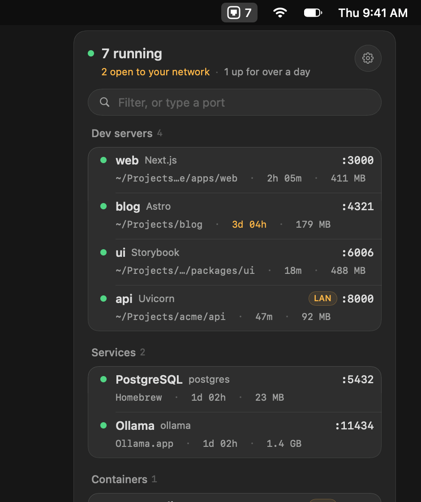
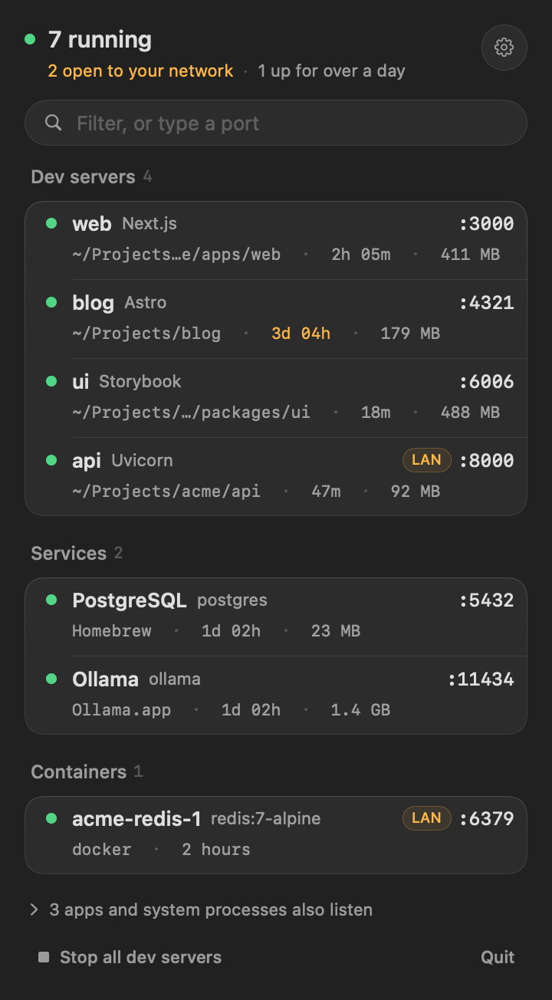
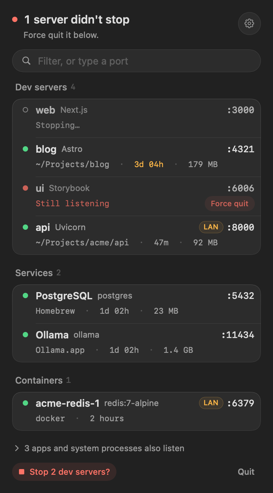

# Portside

[](https://github.com/springmusk026/Portside/actions/workflows/build.yml)
[](LICENSE)

**See every dev server running on your Mac, which project it belongs to, and stop it in one click.**

No more `lsof -i :3000 | grep LISTEN`, then `kill -9`, then finding out it was the wrong Node process.
Portside lives in your menu bar and shows what's listening on your ports, by name: *web · Next.js · :3000*,
not *node 41233*.

<p align="center">
  
</p>

## Features

- **Named by project**: each server shows its project folder, framework, uptime and memory. Portside recognises 120+ frameworks and services: Next.js, Vite, Astro, Remix, SvelteKit, Storybook, Django, FastAPI, Rails, Laravel, Phoenix, Postgres, Redis, Ollama and more.
- **Containers by name**: with Docker Desktop, OrbStack or Colima you see `acme-redis-1 · redis:7-alpine`, not `com.docker.backend`.
- **"Who's on port 3000?"**: type a port in the panel to see who holds it, or that it's free, and free it in one click.
- **Stops servers properly**: it stops the `npm run dev` / `pnpm` / `uv run` runner as well as the listening process, so nothing restarts it. If a server ignores SIGTERM, a **Force quit** button appears.
- **Open to your network**: a `LAN` badge marks servers listening on all interfaces, which other devices on your Wi-Fi can reach. For those, **Copy network URL** gives you `http://192.168.1.24:8000` to test on your phone.
- **Forgotten servers**: anything up for more than a day is flagged.
- **Notifications** when a server starts or stops (optional). They aren't sent for servers you stop from Portside, or for quick restarts during hot reload.
- **Command line**: `portside`, `portside 3000`, `portside kill 3000`, `portside --json`.
- **Native and light**: SwiftUI with no dependencies. It reads sockets straight from the kernel (a full scan takes about a millisecond), makes no network calls and needs no admin rights.

<p align="center">
  
  
  
</p>

## Install

Requires macOS 14 Sonoma or later, on Apple silicon or Intel.

### Download

Get `Portside.zip` from the [latest release](https://github.com/springmusk026/Portside/releases/latest),
unzip it and move `Portside.app` to Applications.

Portside isn't notarized by Apple (it's a free side project), so macOS blocks the first launch. To allow it,
open **System Settings › Privacy & Security** and click **Open Anyway** next to the Portside message, or run:

```sh
xattr -dr com.apple.quarantine /Applications/Portside.app
```

### Build from source

With the Xcode command line tools (`xcode-select --install`):

```sh
git clone https://github.com/springmusk026/Portside.git
cd Portside
./build.sh        # builds, installs to ~/Applications and launches
```

To start Portside at login, use **Settings › Launch at login**.

### Command line

Link the app's binary into your PATH (Settings shows the exact command, with a Copy button):

```sh
ln -sf /Applications/Portside.app/Contents/MacOS/Portside /opt/homebrew/bin/portside
```

```console
$ portside
PORT  NAME  WHAT     PID    UP      REACH    WHERE
3000  web   Next.js  41233  2h 05m  local    ~/Projects/acme/apps/web
8000  api   Uvicorn  41301  47m     network  ~/Projects/acme/api

$ portside 3000          # who holds it? exits 1 if taken, 0 if free
$ portside kill 3000     # stop it (--force for SIGKILL)
$ portside --json        # for scripts, Raycast, SketchyBar
$ portside --all         # include apps and system processes
```

## How it works

- **Finding listeners**: `proc_listallpids` and `proc_pidfdinfo` (libproc) list every TCP socket in `LISTEN` state and its process, the same source `lsof` uses, without spawning anything. Portside rescans every 3 seconds.
- **Naming**: the process's command line (`KERN_PROCARGS2`) gives the framework. Its working directory, walked up to the nearest `package.json`, `pyproject.toml`, `Gemfile`, `go.mod`, `Cargo.toml` or `.git`, gives the project.
- **Containers**: when a container runtime is listening, Portside runs `docker ps` (cached for a few seconds) and matches the published ports.
- **Stopping**: SIGTERM to the listening process and to any runner above it in the same folder (`npm`, `pnpm`, `yarn`, `bun`, `uv`, `bundle`, `cargo`…), or `docker stop` for containers.

**What it can't see:** processes owned by root or another user. When such a process holds a port you look up,
Portside says the port is taken and gives you the `sudo lsof` command to find out more.

## Also from me

- [Sweepside](https://github.com/springmusk026/Sweepside): find the gigabytes your old projects are sitting on (`node_modules`, `.venv`, `target`, DerivedData…) and get them back in one click.
- [Peekside](https://github.com/springmusk026/Peekside): see which apps used your microphone and camera today, and which ones can read what you type.

## Contributing

Is your framework showing up as plain "Node.js"? Teaching Portside a new one is usually a one-line change.
See [CONTRIBUTING.md](CONTRIBUTING.md).

## License

[MIT](LICENSE)
